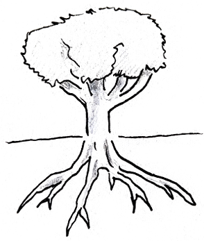

# CLICTree




## For whom?
This is meant for developers of all levels, working in the area of medical image
processing for scientific use. Think of reading DICOM, deidentification, conversion,
metadata extraction, connecting to data sources.

## In which context?
A medical imaging research context. This means that clinicians, researchers, 
IT personel, data managers, legal experts work together to perform all manner
of tasks. The tasks involve medical data of many different sources, for many
different scientific goals, and of many different formats. This all requires
data processing. Everyone uses their own methods for this. PhD students write a 
notebook, clinicians use installed software, the IT department manages a pipeline,
a research group manages its own custom scripts for its own custom research
purposes.


## What is the problem?
Constructive cooperation on code is hard in this context. Quick scripts get to the
point quickly, but are very hard to re-use or share. Thoroughly packaged and
documented solutions are costly to create and maintain and slow to change. For common, 
re-occuring problems it is worth investing extra time. For quick solutions, 
scripts are great and much more efficient. The problem is you don't always
know beforehand which is which.
The result is both wasted effort and lack of progress. Everyone writes scripts
to do the same thing over and over. Larger libraries do not fully connect with
the nitty-gritty world surface they are deployed in. 

## How does CLICTree solve this?
CLICTree makes code modular, specifically for the medical imaging research
domain. It defines common interfaces. Any code that implements such an interface can 
interact with all other code. 

Some desired properties:
* a 3d party package can choose which of the clictree interfaces to implement. 
* A 3d party package must specify the clictree version the interface is defined in. 
* CLICTree should be able validate any interface implementation and preferably fail 
early if the implementing function signature does not conform.
 

## Logging
Clictree uses the standard [logging](https://docs.python.org/3/library/logging.html) module. The root logger is 
called `clictree`. To print log messages, add the following to your code:

```python
import logging
logging.basicConfig(level=logging.DEBUG) 

# Optional: get the root logger to set specific properties
root_logger = logging.getLogger('clictree')
```

## more talk

### Why is this library not called simply 'clic'?
Because that name was taken on pypi. Bit of a branding mistake not to check this.

### Can't AI just solve this?
No. The problem being solved here is a problem of human 
communication and planning. AI can definitely help a lot to take over repetitive
tasks, summarize contents, etc. But the core issue is still one of collaboration,
not of lack of power to solve monotonous tasks.


## About this package

### CLICTree minimizes dependencies
It should be a structuring base, but offer only basic functionality itself. Users
can extend functionality as needed.
To be able effectively offer structure, certain packages will elevated to
core level and included. See point below.

### CLICTree is opinionated
To have structure, you need choices. CLICTree will make choices where needed.
Things like 'All imaging studies are pydicom Datasets'. If enough people disagree
this can be changed of course.

