# Concepts
Explains the clictree structure in more detail

## Domain
All data and users are in a domain.

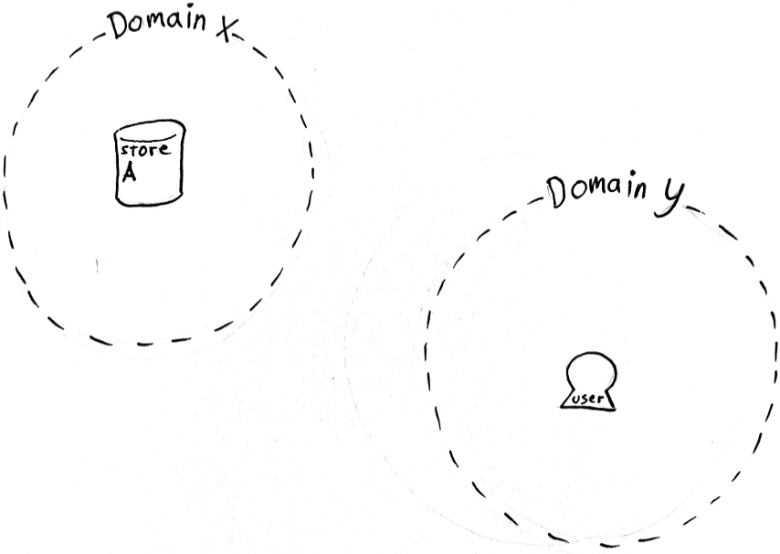

A clictree domain is closely modeled on the EHDS concept of a **pseudonymization domain**
Which is defined as follows in the  [EU guidelines 01/2025 on Pseudonymization, section 2.3, point 35](https://www.edpb.europa.eu/public-consultations/guidelines-012025-on-pseudonymisation_en)) 
  >  "The context in which pseudonymisation is to preclude attribution of data
to specific data subjects"
  
The EU definition in extensive and includes both technical and organizational measures to preclude attribution of data.

For clictree, the following aspects of a domain are important
 
* **Data cannot leave a domain**. The domain boundary is guarded by both technical and 
organizational measures. Crossing the domain boundary can only be done under strict
circumstances (see [links](#link) below).
* **A domain has a purpose**. The data inside a domain can be used for a certain reason.
Research into a specific illness, validating a new tool, publicity, etc. The purpose 
of a domain is an important factor in deciding whether, and if so, how, new data can
be included in a domain.
* **A domain determines its identifiers**. Inside a single domain, the same identifier
always refers to the same thing. Different domains usually use different identifiers.
See below for more on [Identifiers](#identifier) 
* **A domain knows its data containers**. A domain names and organises its data. It
is a link in URI resolution (see [URI](#URI) below)

Sourcecode for [clictree.core.Domain](../reference/clictree/core/#clictree.core.Domain)

## Container

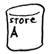

Inside a [domain](#domain), data is organized into `containers`. The two main types
are the [Store](../reference/clictree/core/#clictree.core.Store), which you can ask for
a data item by key, and the [Source](../reference/clictree/core/#clictree.core.Source), which
just gives a data item without a key.

* **Containers are typed** Firstly, a container contains [data items](#data-item) of a single type.
secondly it only takes [identifiers](#identifier) of a single type. 
* **Containers interpret identifiers** A container is in charge of obtaining the data
belonging to an identifier. It interprets the identifier. 

To keep the number of terms under control, the general term `Container` will be used for
any 'thing holding data inside a domain'. When needed, specific subtypes will be used.

## Data Item
Containers contain [Data Items](../reference/clictree/core/#clictree.core.DataItem). All
data in clictree is in the form of data items.

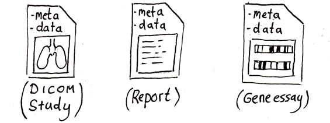

* **Data items can contain any data**. DICOM images, reports, 
a single clinical value, a gene essay result. New types can created by subclassing
[clictree.core.DataItem](../reference/clictree/core/#clictree.core.DataItem).
* **Data items are typed**. The type of data item determines what data it contains, 
which transformations can be applied to it, how it should be read or downloaded.
* **Data items contain separate metadata** The payload data for a data item type
can be anything, the meta section needs to conform to a clictree-wide structure. This
makes it possible to search and query over disparate data item types.

## Link
The only way for data to cross a domain boundary is through a `link`. Links transform
data from one specific container in domain X, and expose this transformed data inside
domain Y. The anchor point in domain Y is a 'Linked container' under the control of 
domain Y.

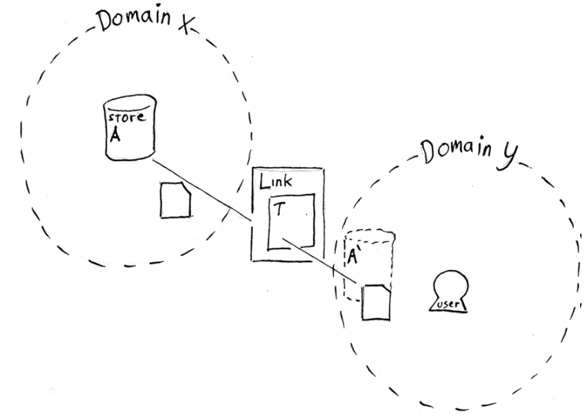

A few important aspects of links

* **Links only link a single container**. Other containers in the same domain are not
accessible
* **Links are directional**. A link can transform data coming from a single container,
but not the other way around.
* **Link creation should be regulated**. A link is a breach in a domain boundary. To
create a link responsibly, source container, transformation and purpose of both domains
should work together to assure protection of patient privacy rights.   

Source for [clictree.core.link](../reference/clictree/core/#clictree.core.Link)

## Identifier
A unique name for something. Used to uniquely identify a piece of data inside a 
[container](#container). Also used to identify other concepts such as a 'patient'.
Contrary to other types of information, identifiers are [mapped](#keymap) between 
domains

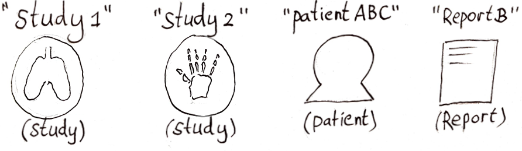

* **Identifiers are tied to domain**. Within a single [Domain](#domain) an identifier 
always points to the same thing. Identifiers change when they cross a domain boundary. 
'patient 1' in domain X can refer to a different patient than 'patient 1' in domain Y.
* **Identifiers are typed**. A patient ID is different from a report ID. clictree 
Containers, Links and KeyMaps only support specific identifier types. New identifiers 
can be created by subclassing [clictree.identifiers.Identifier](../reference/clictree/identifiers/#clictree.identifiers.Identifier).
* **Unique reference in container, not in Domain**. The same identifier can be a key for
two different DataItems. Asking container `A` for the data for Identifier `123` can 
yield a different result than asking container `B` for `123`. As long as the two
different DataItems are both associated with `123` this makes sense. 

## KeyMap
Identifiers change when they cross between domains. In clictree, this change, 
_for a single type of identifier_ is encapsulated by a 
[KeyMap](../reference/clictree/core/#clictree.core.KeyMap).

* **A KeyMap is typed**. A KeyMap describes the changes to a single type of identifier.
For multiple identifier types, multiple KeyMaps are needed. The main reason for this
split is that mapping relationships between identifiers can vary by type. 
* **Change can also be a function**. The way a key changes can be given by an internal
table `key2` = `key1`, but it can also be a function `key2` = `hash(key1)`. New
KeyFile types can be created by subclassing 
[#clictree.core.KeyMap](../reference/clictree/core/#clictree.core.KeyMap). 
* **A KeyMap can be one-way or two-way**. Not all keymaps can translate both ways.
`y = hash(x)` can be easy to compute for unknown `y` but not for unknown `x`. A KeyMap
implementation should raise exceptions if changes are not possible.

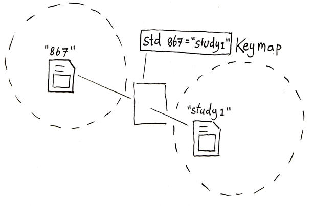

A [KeyMap](../reference/clictree/core/#clictree.core.KeyMap) represents the way one type 
of identifiers change when crossing the domain boundary. In the example above, the 
study identifier "867" on the left is known as "study1" in the domain on the right. 

## KeyFile
A [KeyFile](../reference/clictree/core/#clictree.core.KeyFile) holds [KeyMaps](#Keymap)
for one or more identifiers types. It represents all identifier relationships between
two [domains](#domain) 

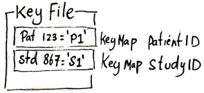

## Interface
The space between two domains. Relation between two domains.

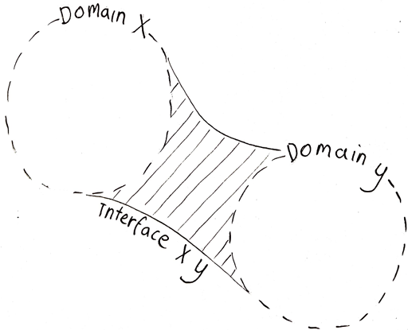

* **Interface is not part of any domain**. As a relationship between domains, it is
not defined one step higher in the clictree [object hierarchy](#object-hierarchy), 
in [Context](#Context)
* **Interface is not directional**. Interface `X-Y` is the same as Interface `Y-X`. 
* **One KeyFile per Interface**. There can be multiple links per interface, but the 
Identifier mapping (defined by a [KeyFile](#keyFile)) must be the same for all links.
Each interface can only have one KeyFile. See example below.

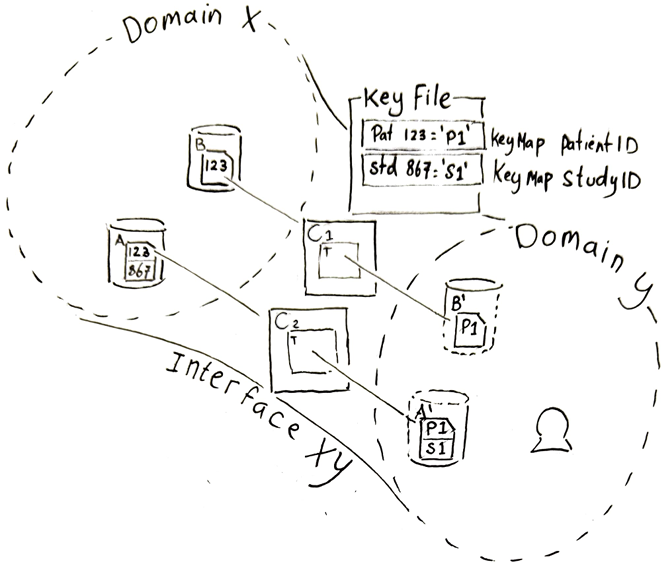

In the example above, `L1` and `L2` are [links](#link) transforming the data 
from [containers](#container) `A` and `B` respectively. `A` and `B` output different
types of [data items](#DataItem) and might transform the data in any way. However, if
they translate an [Identifier](#identifier) such as the Patient ID `123` (in domain X), 
they should always translate this to the _same_ identifier `"P1"` (in domain Y). This
makes it possible for a user in domain Y to know the two DataItems refer to the same
patient.

To make sure consistent mapping is maintained, a single interface can only have a single
KeyFile.

## Context

The highest level in the clictree [object hierarchy](#object-hierarchy). It is the only 
object level higher than domain, and thus is in charge of all cross-domain information.
This includes naming [domains](#domain), holding [interfaces](#interface) and 
orchestrating transformations in [Links](#link). It is also in charge of **credentials**.

## Object hierarchy
All objects in clictree exist in the relationship 
[Context](#context) -> [Domain](#domain) -> [Container](#container) -> [DataItem](#data-item).

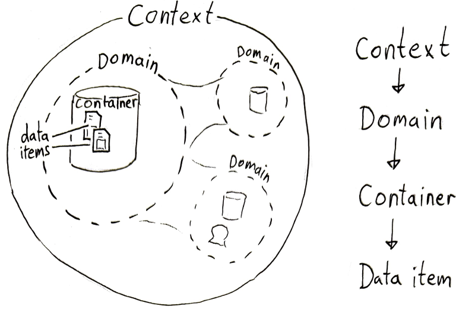

* [Context](#context) the highest level, encompassing all others.
* [Domain](#domain) is in charge of the containers it holds. It names them and know how to 
find them. Domain is the main object level for user authorization. User actions such 
as download and query are done from a specific domain.
* [Container](#container) is the authority on the data items it holds. This means it can provide
data items, determines how to interpret identifiers.
* [DataItem](#data-item) represents a single unit of data with associated meta-data.
  
## URI
Each object in the [object hierarchy](#object-hierarchy) has a unique resource 
identifier (URI) associated with it. The format for a clitree URI is

**/{context name}:{domain name}:{container name}:{uid}**

Because URIs exist in a hierarchy of objects, they have two properties 
[scope](#/reference/clictree/identifiers/#clictree.identifiers.URIScope) and 
[reference level](#/reference/clictree/identifiers/#clictree.identifiers.URIReferenceLevel).
Scope is about the object level at which this URI is useful. For example, it is only useful to
reference which domain something is in, if you are outside this domain yourself. Reference
level is about the object that the URI points to. Is it pointing to a single DataItem? or
to a whole domain?

Some examples:

|  URI                             | Description | Reference level | scope |
| -------------------------------- | ----- | --------------- | ----------- |
| `local:X:A:123`   | Data item `123` in container `A` in domain `X` in context `local` | DataItem | Context |
| `X:A:123`   | Data item `123` in container `A` in domain `X` | DataItem | Domain |
| `A:123`   | Data item `123` in container `A` in domain `X` | DataItem | Container |
| `123`   | Data item `123` | DataItem | DataItem |

Note that a URI is interpreted right to left: a single element `123` is interpreted as
a DataItem. You can also point to objects higher up the hierarchy, but then the root
indicator (`/`) is required:

|  URI                             | Description | Reference level | scope |
| -------------------------------- | ----- | --------------- | ----------- |
| `/local:X:A`   | Container `A` in domain `X` in context `local` | Container | Context |
| `/local:X`   | Domain `X` in context `local` | Domain | Context |
| `/local`   | Context `local` | Context | Context |

Finally, you can reference objects halfway up the hierarchy but using the root indicator
and leaving higher elements empty:

|  URI                             | Description | Reference level | scope |
| -------------------------------- | ----- | --------------- | ----------- |
| `/:X:A`   | Container `A` in domain `X` (without context) | Container | Domain |
| `/:X`   | Domain `X` | Domain | Domain |

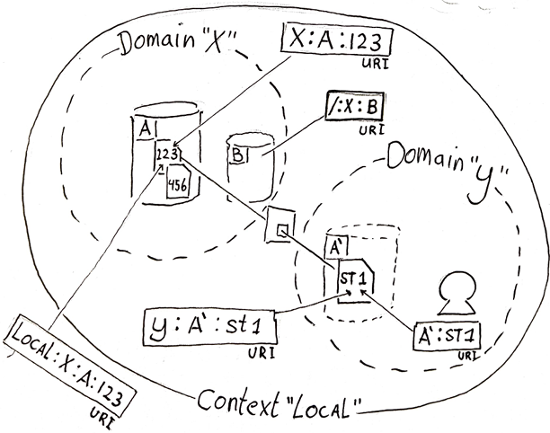

In this example, each URI is drawn at the level in which it is used:

* `LOCAL:X:A:123` is a context-scoped DataItem-level URI. Meaning it can be used outside
a context to refer to a single data item.
* `X:A:123` can be used inside a context to refer to a single data item `123` inside a 
container `A` inside a domain `X`. This type of URI might be used by a context when
converting data items between domains.
* `A':St1` can be used inside domain `Y` to refer to a single data item `St1` in 
container `A'`

Using the URIs in the image above, a data request from the user in domain `Y` can be
described as follows:

* Inside domain `Y`, a user requests `A':St1`. 
* This request is sent to `A'`, which is a [linked container](../reference/clictree/core/#clictree.core.LinkedContainer)
linked to `/:X:A`, through a Link. The context uses the Link to translate `St1` to `123`
and sends a request `X:A/123`.
* Container `A` receives a request for `123`. It comes up with a data item '123' and 
sends it back through the link.
* The context uses the Link again to transform data item '123', changing any mention of
'123' back to 'St1'. The transformed data item is then sent back through linked container
`A'`
* User receives the data item referenced by `A:St1`.

See [clictree.identifiers.URI](../reference/clictree/identifiers/#clictree.identifiers.URI)
 

