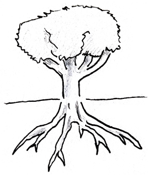

# clictree

[](https://github.com/psf/black)




Structures data access, sharing and pseudonymization for secondary use of 
clinical medical imaging data.

* Extendable bython base classes for data, sources, identifier management.
* Based on EHDS pseudonymization domains and privacy legislation.
* Facilitates data reproducibility through URI-based naming scheme of data transformations. 
* Integrates technical and organisational structures such as data access agreements.

## Installation
```
pip install clictree
```

## Documentation
See [clictree docs on readthedocs.io](https://clictree.readthedocs.io)
